<div align="center">

[Deutsch](README.md) | **English**

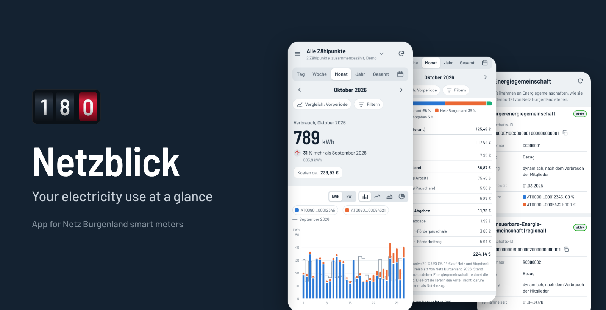

<a href="https://github.com/sponsors/xionix3"></a><br />
<sub>☕ Netzblick is and stays free – no ads, no subscription. If you like the app, I'd be happy about a coffee. Entirely voluntary, thank you! ❤</sub>

[](https://github.com/xionix3/netzblick/actions/workflows/ci.yml)
[](https://github.com/xionix3/netzblick/releases)

</div>

**Netzblick** shows your smart meter data from Netz Burgenland, the distribution grid operator in Burgenland (Austria), clearly on phone and tablet. It covers consumption in quarter hours, days, months and years, and your power peaks for the power-based grid price from 2027. It also shows what your electricity costs, plus your installations, bills and energy communities. You sign in with your usual account. The [smart meter portal](https://smartmeter.netzburgenland.at/enview/enView.Portal/) and the [customer portal](https://portal.netzburgenland.at/) share the same login, and Netzblick combines both.

> Netzblick is a private project by geister-it and **not an official app** of Netz Burgenland. It uses the same interfaces as the web portals. If Netz Burgenland changes them, the app may stop working for a while.
>
> **The app itself is in German**, as are the detailed documents in `docs/`. This page summarises everything in English.

## Contents

- [Screenshots](#screenshots)
- [Features](#features)
- [Installation](#installation)
- [How to use it](#how-to-use-it)
- [Figures and costs explained](#figures-and-costs-explained)
- [Privacy and security](#privacy-and-security)
- [Staying up to date](#staying-up-to-date)
- [Building it yourself](#building-it-yourself)
- [Troubleshooting](#troubleshooting)
- [Development](#development)
- [Tests](#tests)
- [Releases](#releases)
- [License](#license)

## Screenshots

All images show demo mode with made-up sample data.

<table>
  <tr>
    <td align="center" width="25%">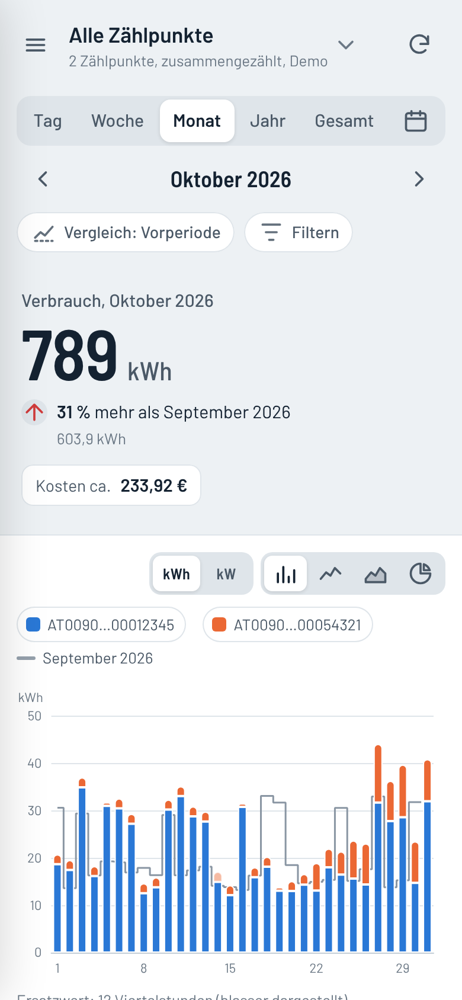<br /><sub><b>Overview</b><br />total, comparison, forecast</sub></td>
    <td align="center" width="25%">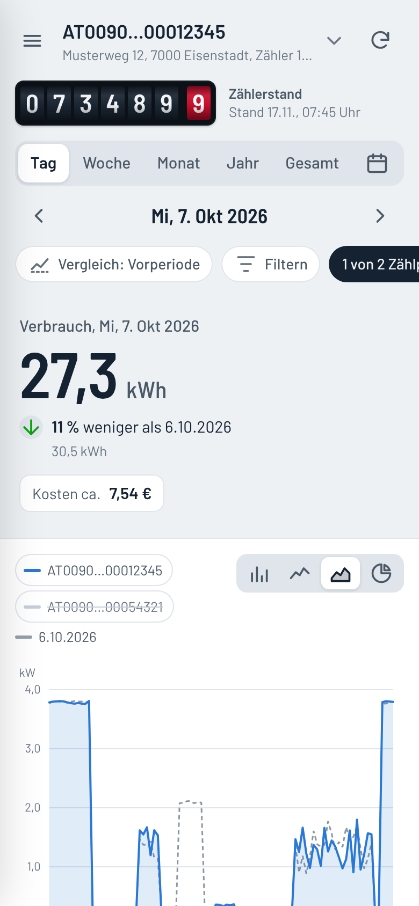<br /><sub><b>Day</b><br />meter reading and quarter hours</sub></td>
    <td align="center" width="25%">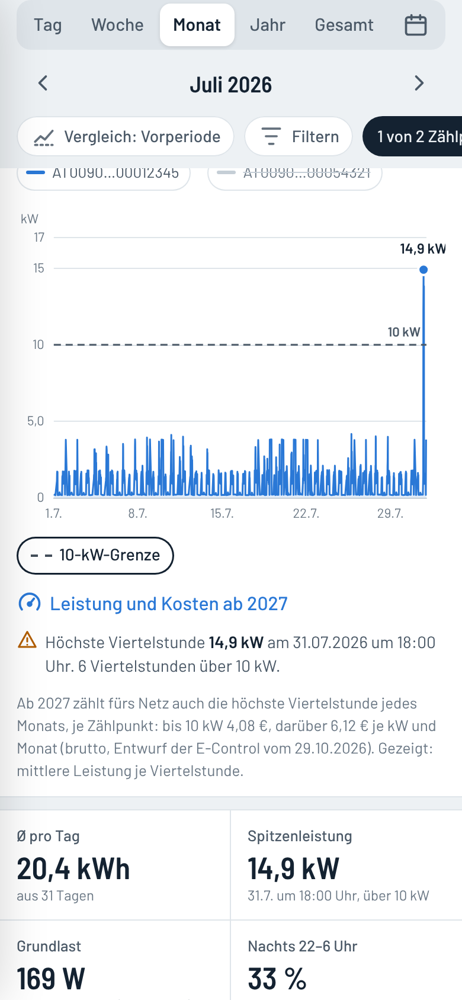<br /><sub><b>Power</b><br />quarter hours, 10 kW limit</sub></td>
    <td align="center" width="25%">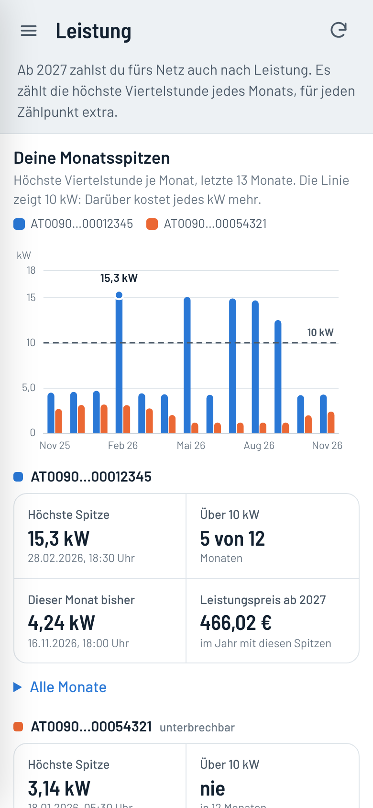<br /><sub><b>Power from 2027</b><br />monthly peaks, cost comparison</sub></td>
  </tr>
  <tr>
    <td align="center">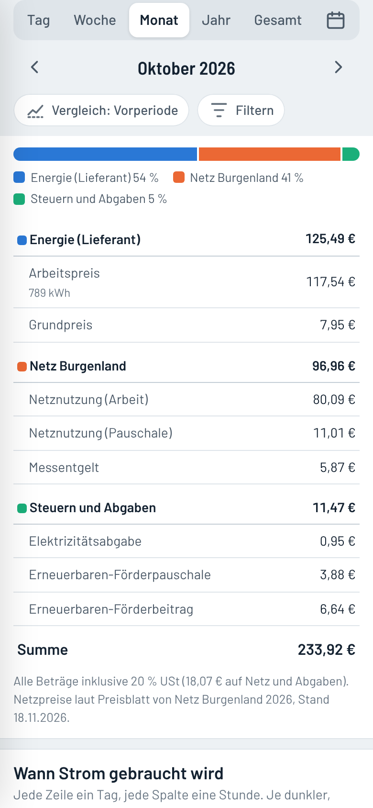<br /><sub><b>Costs</b><br />energy, grid, taxes</sub></td>
    <td align="center">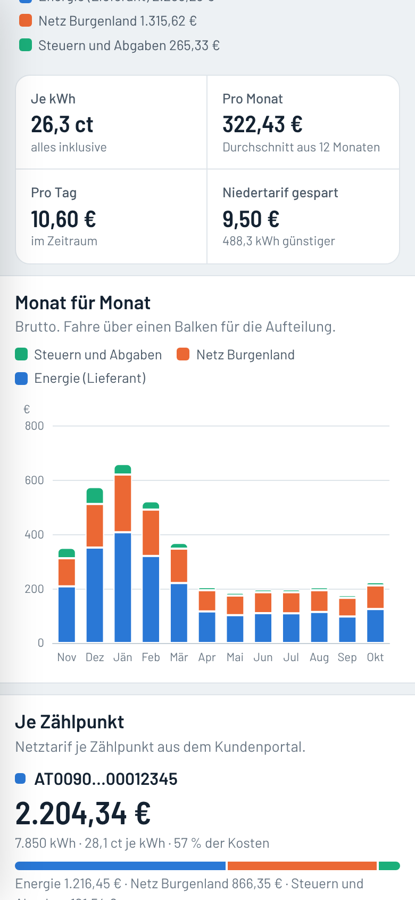<br /><sub><b>Costs per year</b><br />month by month, per meter</sub></td>
    <td align="center">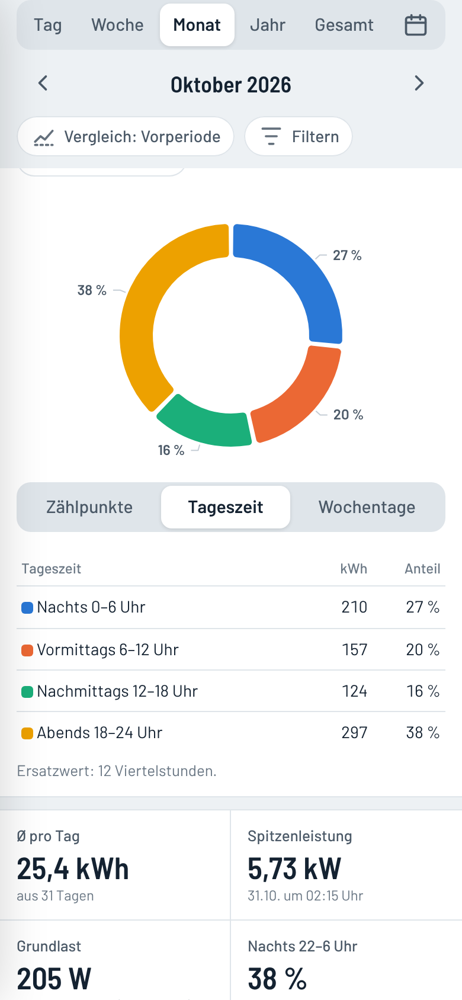<br /><sub><b>Breakdown</b><br />by meter, time of day, weekday</sub></td>
    <td align="center">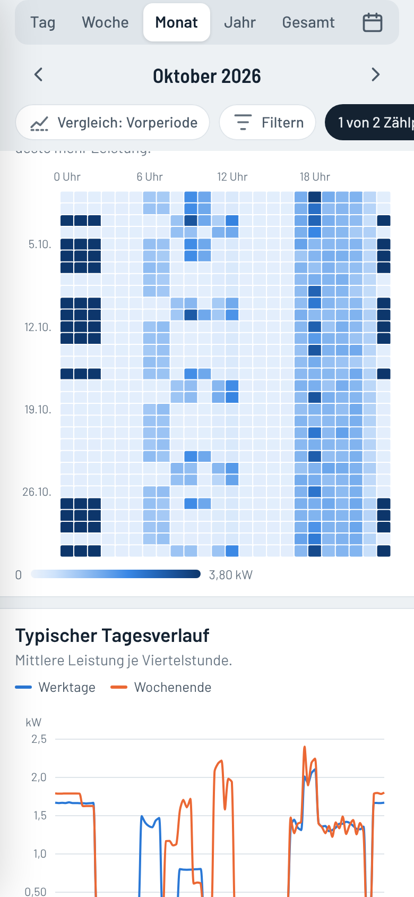<br /><sub><b>Analysis</b><br />load map and daily profile</sub></td>
  </tr>
  <tr>
    <td align="center">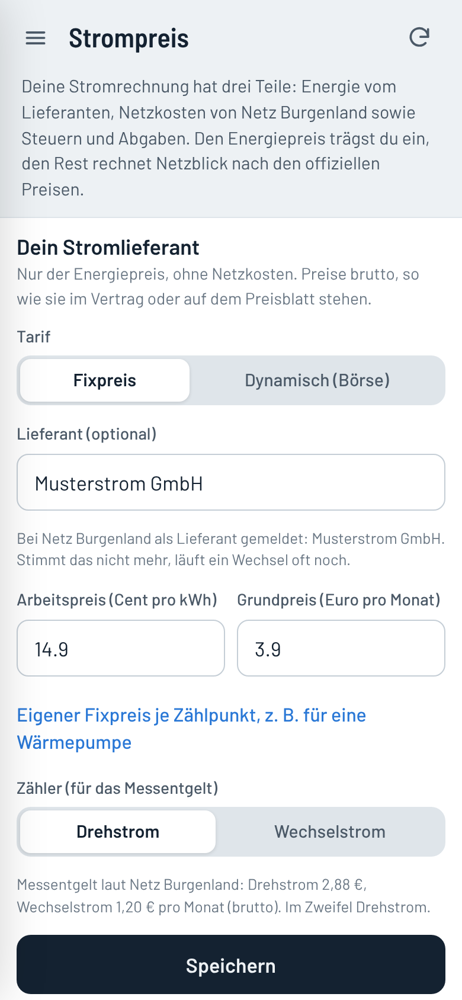<br /><sub><b>Electricity price</b><br />supplier and reminder</sub></td>
    <td align="center">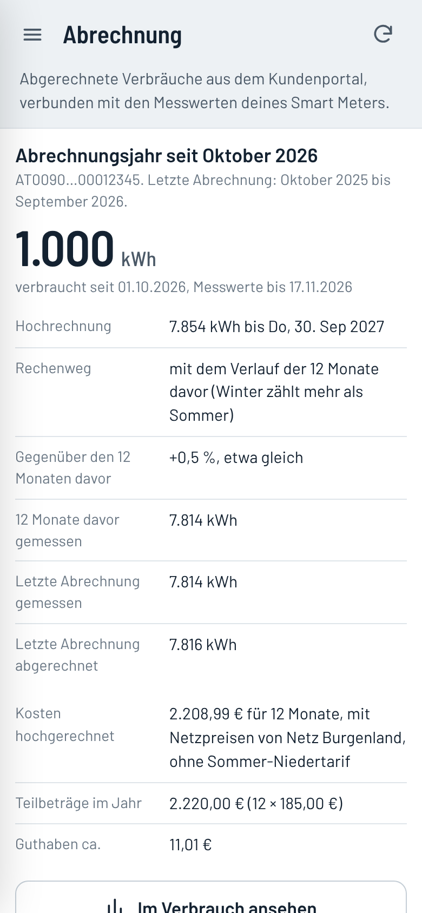<br /><sub><b>Billing</b><br />forecast and instalments</sub></td>
    <td align="center">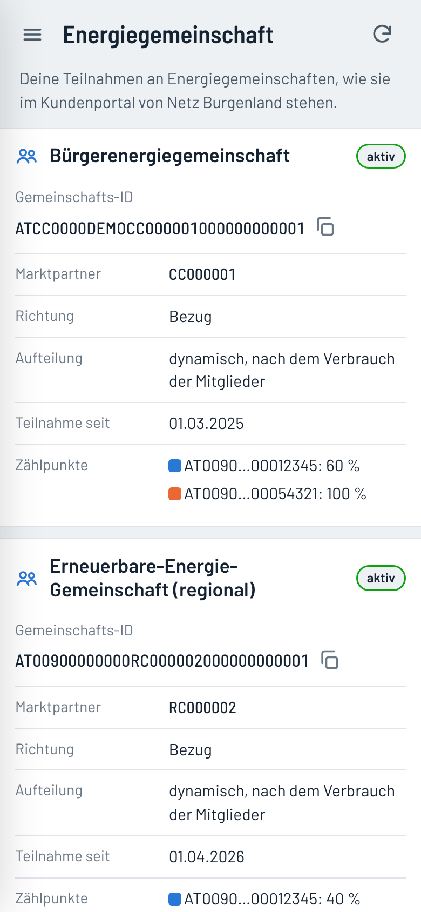<br /><sub><b>Energy community</b><br />memberships and factors</sub></td>
    <td align="center">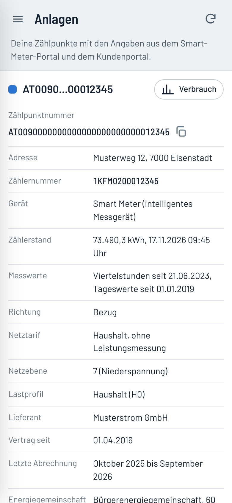<br /><sub><b>Installations</b><br />meter, grid tariff, supplier</sub></td>
  </tr>
  <tr>
    <td align="center">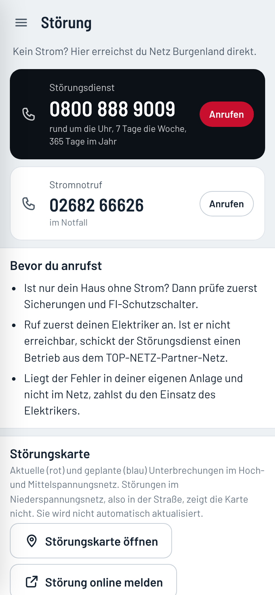<br /><sub><b>Power outage</b><br />call directly</sub></td>
    <td align="center">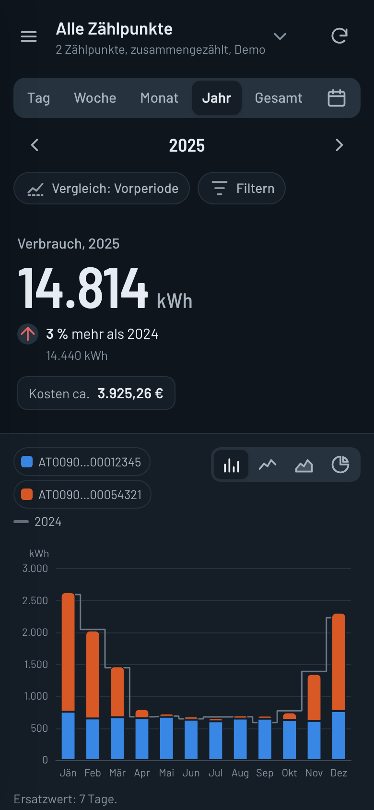<br /><sub><b>Dark mode</b><br />year comparison</sub></td>
    <td align="center">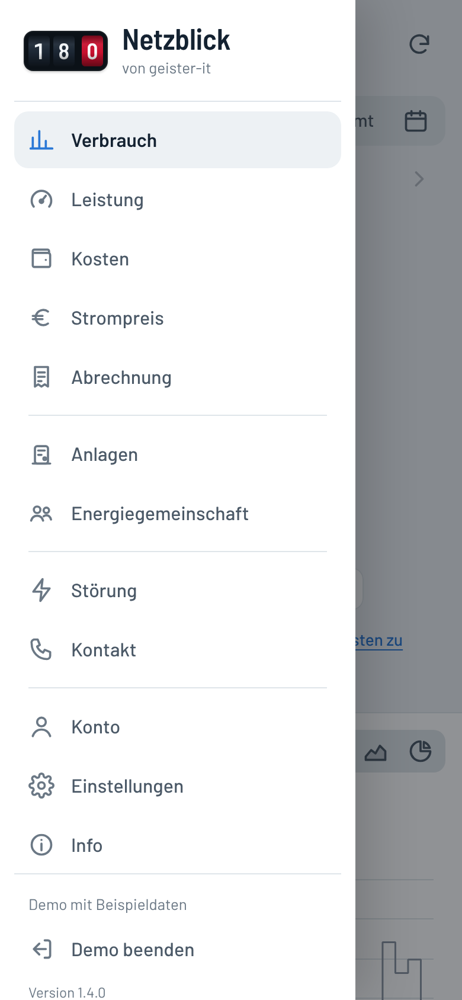<br /><sub><b>Menu</b><br />everything one tap away</sub></td>
    <td align="center">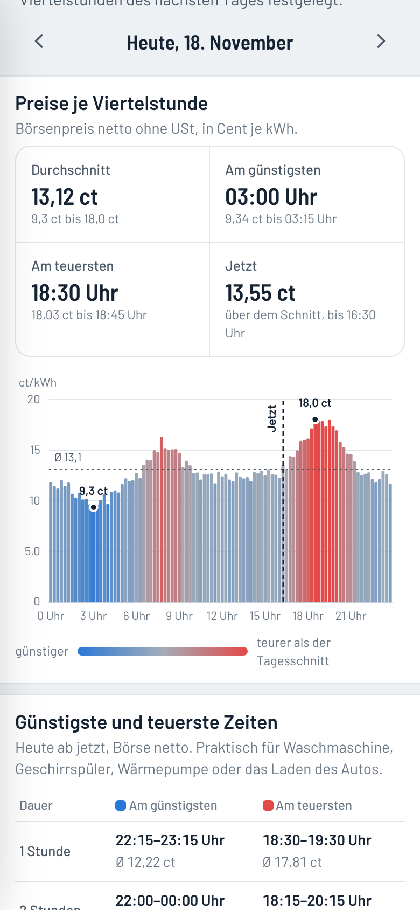<br /><sub><b>Exchange price</b><br />cheap and expensive, neighbours</sub></td>
  </tr>
</table>

<p align="center">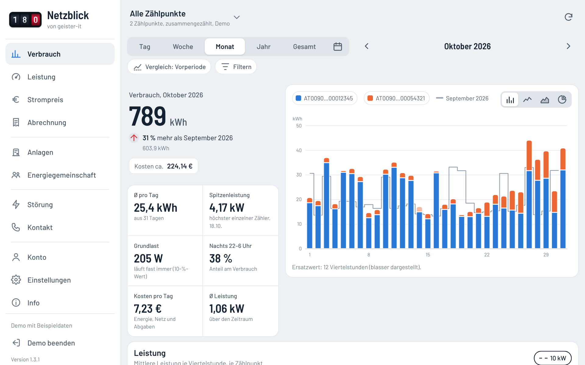<br /><sub><b>Tablet</b>: menu on the side, totals next to the chart. A phone in landscape shows both side by side too.</sub></p>

## Features

### Consumption

| | |
|---|---|
| **Periods** | Day, week, month, year, all time and custom, including "since the last bill". Swipe or use the arrows. |
| **Meter reading** | Current reading of the consumption register, shown as a rolling counter. |
| **Comparison** | Against the previous period or the previous year; running periods are compared up to the same point in time. |
| **Charts** | Bars, lines, area or donut. Load curve in quarter hours, bars per day, month or year, comparison as a grey line. |
| **Analysis** | Load heat map, typical daily profile (weekdays, weekends), consumption per weekday, year calendar, years compared. |
| **Filters** | Weekdays and hours (e.g. nights 10 pm–6 am); they apply to all figures and charts. |
| **Several meters** | Combine any metering points and toggle them in the chart legend. Without a custom name, each one is called by its metering point number. |
| **Values and export** | Value table and CSV export (Excel-friendly). Substitute, provisional and missing values are marked. |

### Power (from 2027)

| | |
|---|---|
| **Power chart** | Its own chart right below consumption: average power of every quarter hour in kW, even for a whole month. For year and all time the highest quarter hour per month. |
| **10 kW line** | Shown or hidden at the top right of the chart. From 2027, the part of the monthly peak above 10 kW costs more. The highest peak is marked, and below the chart each meter shows how often it went above 10 kW. |
| **"Leistung" page** | Monthly peaks of the last 13 months per meter, months above 10 kW, the peak so far this month, yearly power price, grid costs 2026 vs. from 2027, tips. |
| **Basis** | E-Control's draft tariff regulation 2027 (29 Oct 2026), Burgenland grid area. Netz Burgenland has announced the switch for January 2027. |

### Exchange price

| | |
|---|---|
| **Day-ahead prices** | A page of its own with the EPEX Spot Austria prices for every day since October 2018, today and, from about 1 pm, tomorrow. Bars per quarter hour or per hour (switchable): blue is cheaper, red more expensive than the day's average. Average, cheapest and most expensive quarter hour, price right now. |
| **Cheapest and most expensive times** | The best and the most expensive 1, 2, 3 and 4 hours in a row, today from now on. For the washing machine, dishwasher, heat pump or charging the car. |
| **Where is it cheaper?** | Daily average in Austria, Germany, Switzerland, Czechia, Hungary, Slovenia and northern Italy, with a table. |
| **When is it usually cheap?** | Over 7 days up to 12 months: every day hour by hour as a carpet, the typical day for weekdays and weekends, negative prices. |
| **Your price** | With a dynamic tariff the page can show your final price with markup and VAT instead of the exchange price. |

### Costs and billing

| | |
|---|---|
| **Electricity price** | Fixed price (energy price and base fee) or a **dynamic tariff**: EPEX Spot Austria exchange price plus a markup in cents and/or percent, per quarter hour or hour. Presets for aWATTar, smartENERGY, VERBUND and oekostrom. A fixed price per meter (e.g. a heat pump) is possible. |
| **Exchange price today and tomorrow** | With a dynamic tariff: your energy price now, on average, and the cheapest two hours today and tomorrow, as a chart. Exchange prices from Energy-Charts (Fraunhofer ISE), data Bundesnetzagentur/SMARD, CC BY 4.0. |
| **Grid costs** | Calculated from Netz Burgenland's price sheet, including the summer low tariff (1 April to 30 September, 10 am–4 pm) taken from the quarter-hour values. From 2027 including the power price from the monthly peak and the winter low tariff (from October 2027, 11 pm–5 am). Whether a meter is a household or interruptible tariff comes from the customer portal. |
| **Taxes and levies** | Electricity tax, renewable energy flat fee and renewable energy contribution, 20 % VAT. |
| **Cost breakdown** | In the overview with shares; cost per day and forecast for the period. "What a year costs you" based on the last 12 months. |
| **"Kosten" page** | Last 12 months or a calendar year: total and shares, cost per kWh, per month and per day, month-by-month chart (energy, grid, levies), cost per meter, full breakdown, table of all months as CSV. Calculated from quarter-hour values, so low tariffs are exact. |
| **Reminder** | Notification and in-app hint before a new-customer discount or a minimum term ends; calendar entry; link to E-Control's tariff calculator. |
| **Billing** | Current billing year with forecast, measured vs. billed, costs vs. instalments, billed annual consumption, bills. |

### Netz Burgenland

| | |
|---|---|
| **Installations** | Metering point number, address, meter number, device, grid tariff, grid level, load profile, supplier, contract start, last bill. |
| **Energy community** | All memberships: type, community ID, market partner, direction, allocation model, status, participation factor per meter and history. |
| **Power outage** | Call the fault service or emergency line directly, tips before calling, outage map, online report. |
| **Contact** | Customer hotline, e-mail, contact form, service centres with map links, topic links. |

### Convenience

Portrait and landscape, built for phones and tablets, dark mode, offline display of the last loaded values, automatic re-login, demo mode with sample data, animated logo on start.

## Installation

1. Download the latest `netzblick-X.Y.Z.apk` from [**Releases**](https://github.com/xionix3/netzblick/releases) on your phone.
2. Open the file. Android asks once whether your browser or file manager may install apps: allow it.
3. Open Netzblick and sign in with the username (or e-mail) and password of your Netz Burgenland account. If you use a different account for the customer portal, expand "Andere Zugangsdaten für das Kundenportal?".

Updates install the same way, over the existing app. Requires Android 7.0 or newer.
No account yet? Register at [portal.netzburgenland.at](https://portal.netzburgenland.at/auth/). To try it out, tap **"Demo mit Beispieldaten ansehen"** on the sign-in screen.

## How to use it

- **Menu:** ☰ at the top left, or swipe in from the left edge. On tablets it stays on the side.
  It contains Verbrauch (consumption), Leistung (power), Kosten (costs), Strompreis (price), Abrechnung (billing), Anlagen (installations), Energiegemeinschaft, Störung (outage), Kontakt, Konto (account), Einstellungen (settings), Info and Abmelden (sign out).
- **Period:** the bar at the top. The calendar icon opens a custom period with presets.
- **Browse:** arrows next to the date, or swipe across the total. Tap the date to pick one.
- **Meters:** tap the name at the top (tick several or "nur dieser"), or tap them in the chart legend.
- **Power:** its own chart below consumption; toggle the 10 kW line at its top right.
- **Chart type:** icons above the chart; the choice is remembered per resolution.
- **Comparison and filters:** chips below the date. Active filters turn dark and can be removed with ✕.
- **Strompreis:** supplier price (incl. VAT), reminder, yearly cost, grid prices.
- **Konto:** status of both portals and how the app signs in to the customer portal.
- **Einstellungen:** meter names, light or dark.

## Figures and costs explained

| Figure | Meaning and calculation |
|---|---|
| **Consumption** | Sum of all values in the period in kWh, filtered if a filter is active. |
| **Comparison** | Change against the comparison period. If the period is still running, the comparison is cut to the same length. |
| **Forecast** | Average per day × days of the whole period; shown from 1 day of data (week), 3 days (month) or 14 days (year). |
| **Average per day** | Consumption ÷ days with values; partial days count proportionally. |
| **Peak power** | Highest quarter-hour value × 4 = average power in kW during that quarter hour. With several meters, the highest single meter. |
| **Power price (from 2027)** | Per meter and month the highest quarter hour, rounded to two decimals: up to 10 kW × €3.40, the part above × €5.10 (net, draft). Example 12 kW: 10 × 3.40 + 2 × 5.10 = €44.20 net per month. Interruptible meters pay none. |
| **Base load** | 10th percentile of quarter-hour power: what is practically always running. A good place to start saving. |
| **Night 10 pm–6 am** | Share of consumption between 10 pm and 6 am. |
| **Costs** | **Supplier:** kWh × energy price + base fee pro rata (incl. VAT, as entered). **Netz Burgenland** (grid level 7, net + 20 % VAT): kWh × grid usage price, quarter hours from April to September between 10 am and 4 pm at the summer low tariff, plus the yearly flat fee and the monthly metering fee pro rata. **Levies:** electricity tax per kWh, renewable energy flat fee per year, renewable energy contribution per year and per kWh. Prices live in [`src/netzdaten.js`](src/netzdaten.js). This is an estimate; your bill is what counts. |
| **Billing year** | Consumption since the end of the last bill × (consumption of the 12 months before ÷ the same span one year earlier), so winter weighs more than summer. From 14 days on. |

**Data sources:** quarter-hour values (register 1.8.0, from mid-2023) and daily values per tariff (1.8.1/1.8.2, since the smart meter was installed); Netzblick picks the finest data available. Values arrive about one day late.
**Status codes:** W = measured, E = substitute, V = provisional, F = missing, G = faulty, M = manual. Everything other than "W" is shown paler or marked in the table.

## Privacy and security

- Netzblick talks to `smartmeter.netzburgenland.at` and `api.portal.netzburgenland.at` (HTTPS). For the exchange price page and a dynamic tariff it also fetches public exchange prices from `api.energy-charts.info`, without any data about you. No own server, no ads, no tracking.
- Data from the customer portal is **read only**.
- **Credentials** are stored only with "Angemeldet bleiben" (stay signed in), encrypted with AES-256-GCM; the key lives in the Android Keystore.
- **Values** are cached for offline display. Signing out deletes credentials and cache.
- Android backups are disabled. Permissions: internet, notifications (only for the reminder), boot completed (so a scheduled reminder survives a restart).

Details in the [privacy policy](DATENSCHUTZ.md) (German).

## Staying up to date

For everyone who builds the app with Android Studio. New versions arrive on GitHub in the `main` branch.

**On Windows:** double-click **`aktualisieren.cmd`** in the project folder. It pulls the latest version from GitHub, installs new packages and copies the web part into the Android project. Then press **Run** ▶ in Android Studio.

**By hand** (cmd, PowerShell or a terminal, in the project folder):

```bash
git pull
npm run sync
```

`npm run sync` installs missing packages itself and builds the web part. Then **Run** ▶ in Android Studio.

> Don't edit files in the project folder by hand, then `git pull` always works. If Android Studio changed files (e.g. a suggested Gradle upgrade), `git checkout -- android` resets them.

Without Android Studio it's even simpler: install the latest APK from [Releases](https://github.com/xionix3/netzblick/releases) on your phone.

## Building it yourself

| Tool | Version | Note |
|---|---|---|
| [Node.js](https://nodejs.org) | 22 or newer | see `.nvmrc` |
| [Android Studio](https://developer.android.com/studio) | **Otter (2025.2.1) or newer** | ships JDK 21 and the Android SDK |
| Git | current | |

```bash
git clone https://github.com/xionix3/netzblick.git
cd netzblick
npm run sync          # install packages, build the web part, copy it into the Android project
```

Then open the **`android/`** folder in Android Studio, wait for Gradle, connect a phone with USB debugging and press **Run**. With the SDK but without Android Studio: `npm run apk`.
Every push also builds a debug APK on GitHub (**Actions** → run → **Artifacts**).

## Troubleshooting

| Message / problem | Fix |
|---|---|
| `incompatible version (AGP 8.13.0) of the Android Gradle plugin` | Android Studio is too old: install Otter (2025.2.1) or newer. |
| Android Studio suggests upgrading to AGP 9 | Decline. Capacitor 8 is tested with AGP 8.13. |
| `error: invalid source release: 21` | *Settings → Build Tools → Gradle → Gradle JDK*: choose the bundled JDK 21. |
| `SDK location not found` | Open the project once in Android Studio or set `ANDROID_HOME`. |
| `Could not resolve "@capacitor/…"` | A new package came with `git pull`. From version 1.2.0 `npm run sync` installs it itself; otherwise run `npm install` once. |
| `npm warn install-scripts … esbuild … blocked` (npm 12) | Already allowed in `package.json`. Run `npm rebuild esbuild` once. After `npm install-scripts approve`: `git checkout -- package.json`. |
| Sign-in fails although the password is right | Sign in on the [web portal](https://smartmeter.netzburgenland.at/enview/enView.Portal/); if it asks for a new password, change it there. |
| Today's values are missing | Normal, values arrive about one day late. |
| "Anlagen" or "Abrechnung" is empty | Check the customer portal access under *Konto*; choose "Eigene Zugangsdaten" if needed. |
| "Rechnungen stellt … aus" | Your supplier bills you directly; consumption and forecast still work. |
| "App not installed" on update | Different signature (debug vs. release): uninstall the old version and install again. |
| No reminder notification | Allow notifications for Netzblick in Android settings; the in-app hint appears anyway. |

## Development

The source code, comments and detailed docs are in German.

```
netzblick/
├── src/                 app logic (JavaScript, bundled with esbuild)
│   ├── api.js           smart meter API: sign-in, series, peak power
│   ├── kundenportal.js  customer portal: profile, metering points, energy communities, contracts, billing
│   ├── model.js         loading, caching, filters, figures, breakdowns
│   ├── costs.js         cost model: supplier, grid, levies, low tariffs, power price from 2027
│   ├── costview.js      cost breakdown for the overview and the costs page
│   ├── spot.js          EPEX Spot exchange prices for Austria and neighbours (Energy-Charts)
│   ├── spotstats.js     exchange price analysis: time windows, typical day, carpet
│   ├── spotpage.js      "Börsenpreis" page
│   ├── netzdaten.js     grid prices, levies, outage and contact data (with sources)
│   ├── billing.js       current billing year and forecast
│   ├── reminder.js      reminder date and calendar file
│   ├── charts.js        charts (Apache ECharts)
│   ├── main.js          start, sign-in, menu, consumption view
│   ├── pages.js         pages: power, costs, price, billing, installations, energy community, outage, contact, account, info
│   ├── ui.js            DOM helpers, bottom sheet, rolling counter, logo
│   ├── platform.js      native bridge: HTTP without CORS, secure storage, share, notifications
│   ├── demo.js          demo data in the format of the real APIs
│   └── cache.js, format.js, icons.js, time.js
├── www-src/             index.html and app.css
├── android/             Capacitor Android project (SecureStorePlugin.java: Keystore encryption)
├── test/unit/           unit tests (node:test)
├── test/e2e/            UI test in real Chrome
├── scripts/             build, release and image scripts
└── docs/                images for README and store, screenshots
```

| Command | Purpose |
|---|---|
| `npm test` | unit tests |
| `npm run build` | build the web part into `www/` (installs missing packages) |
| `npm run sync` | build and copy into the Android project |
| `npm run test:e2e` | UI test in Chrome |
| `npm run screenshots` | UI test, updates `docs/screenshots/` |
| `node scripts/readme-images.mjs` | images for this README (`docs/readme/`) |
| `node scripts/store-assets.mjs` | Google Play graphics (`docs/store/`) |
| `npm run check` | tests, build and UI test together |
| `npm run apk` | debug APK from the command line |

**In the browser:** `npm run build`, serve `www/` with a local web server (e.g. `npx serve www`) and append `?demo=1`. Real sign-in only works in the app, because the browser blocks the portal APIs (CORS).

## Tests

Every push runs three stages on GitHub ([CI](.github/workflows/ci.yml)):

1. **Unit tests** (`test/unit/`, 96 cases):
   - periods incl. daylight saving time, number formats
   - API clients with error cases and re-login
   - data model and filters, cache
   - customer portal and energy communities
   - billing year incl. interim bills
   - cost model, checked against Netz Burgenland's comparison chart
   - power price 2027 with monthly peaks and winter low tariff
   - exchange prices and dynamic tariff (quarter hour, hourly mean, daily mean, missing prices)
   - exchange price analysis: neighbouring zones, wait times of the service, time windows, typical day
   - reminder and calendar file, version numbers
2. **UI test** (`test/e2e/smoke.mjs`, 31 scenarios):
   - all periods, dark mode, filters, multi-select, chart types, power chart with 10 kW line
   - costs and reminder, exchange prices with neighbouring countries, every page
   - tablet, landscape, tall status bar, sign-out
   - checks for console errors, empty views and broken text
3. **Android build:** builds the debug APK.

## Releases

New version: add an entry to [CHANGELOG.md](CHANGELOG.md), raise the version in `package.json` and push to `main`. GitHub builds a signed APK and AAB, sets the tag and publishes both under **Releases**.

## License

[MIT](LICENSE), © 2026 geister-it. Netzblick is not affiliated with Netz Burgenland or VIVAVIS; names belong to their owners.
Uses [Capacitor](https://capacitorjs.com) (MIT), [Apache ECharts](https://echarts.apache.org) (Apache-2.0) and the [Barlow](https://github.com/jpt/barlow) typeface (SIL OFL 1.1).
