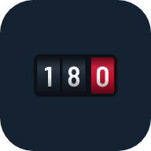
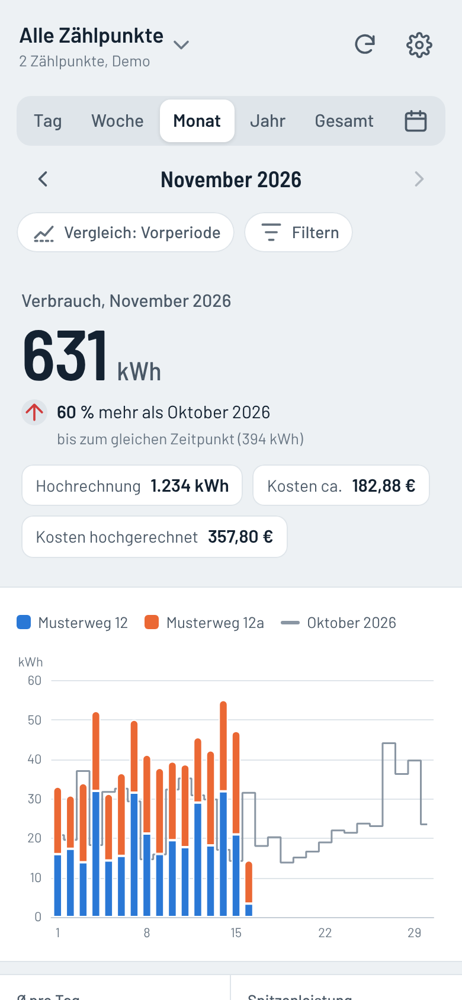
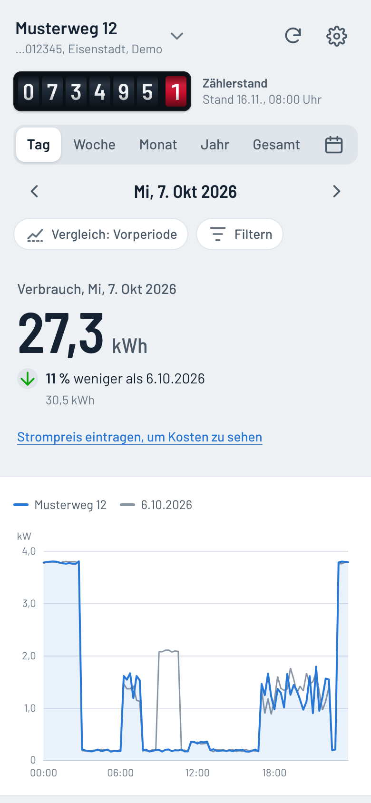
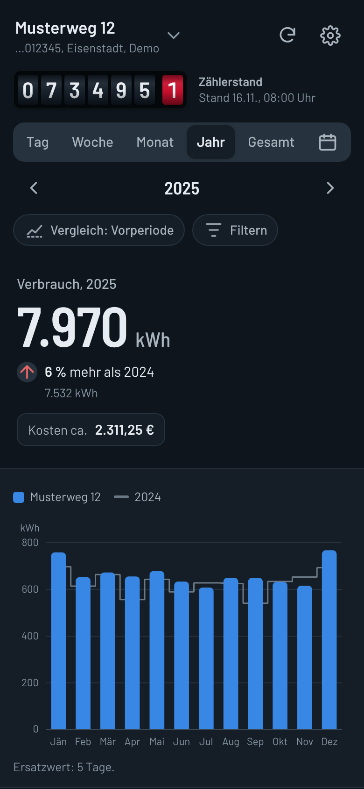
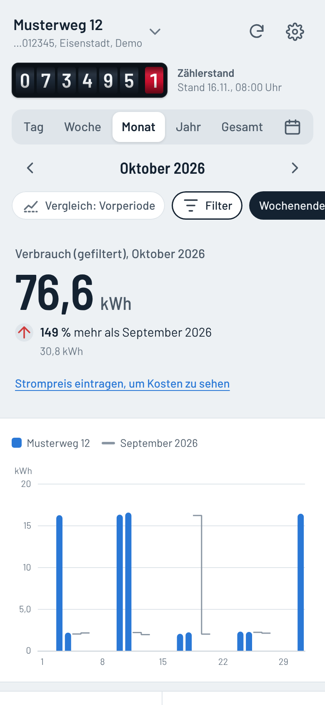
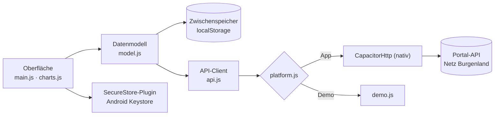

<div align="center">



# Netzblick

**Deine Smart-Meter-Daten von Netz Burgenland, übersichtlich auf dem Handy.**

[](https://github.com/xionix3/netzblick/actions/workflows/ci.yml)
[](https://github.com/xionix3/netzblick/releases)






</div>

Netzblick holt die Messwerte deines Smart Meters aus dem
[Verbrauchsdatenportal von Netz Burgenland](https://smartmeter.netzburgenland.at/enview/enView.Portal/)
und zeigt sie als Diagramme, Kennzahlen und Tabellen, die du nach Zeitraum,
Wochentag und Uhrzeit filtern kannst. Du meldest dich mit deinem gewohnten
Portal-Zugang an.

> Netzblick ist ein privates Projekt und **keine offizielle App** von Netz Burgenland.
> Es nutzt dieselbe Schnittstelle wie das Web-Portal. Ändert Netz Burgenland diese, kann die App vorübergehend ausfallen.

---

## Inhalt

- [Funktionen](#funktionen)
- [Installation](#installation)
- [Bedienung](#bedienung)
- [Kennzahlen erklärt](#kennzahlen-erklärt)
- [Datenschutz und Sicherheit](#datenschutz-und-sicherheit)
- [Selbst bauen](#selbst-bauen)
- [Fehlerbehebung](#fehlerbehebung)
- [Entwicklung](#entwicklung)
- [Tests](#tests)
- [Releases und Play Store](#releases-und-play-store)
- [Lizenz](#lizenz)

## Funktionen

| Bereich | Was Netzblick kann |
|---|---|
| **Zeiträume** | Tag, Woche, Monat, Jahr, Gesamt und frei wählbarer Zeitraum. Wechseln mit Pfeilen, Wischen oder Tippen aufs Datum. |
| **Zählerstand** | Aktueller Stand des Bezugszählers (OBIS 1.8.0) im Stil eines Rollenzählwerks. |
| **Vergleich** | Mit der Vorperiode oder dem Vorjahr. Bei laufenden Zeiträumen fair bis zum gleichen Zeitpunkt. |
| **Hochrechnung und Kosten** | Prognose für den laufenden Zeitraum. Kosten nach deinem eigenen Strompreis. |
| **Diagramme** | Leistungskurve in 15-Minuten-Schritten (Tag, Woche), Balken je Tag, Monat oder Jahr. Vergleich als graue Linie. |
| **Analysen** | Lastgang-Teppich (wann am Tag Strom gebraucht wird), typischer Tagesverlauf (Werktag und Wochenende), Verbrauch je Wochentag, Jahreskalender, Jahre im Vergleich. |
| **Filter** | Nur bestimmte Wochentage (z. B. Werktage) und/oder Uhrzeiten (z. B. 22–6 Uhr). Wirken auf alle Zahlen und Diagramme. |
| **Mehrere Zählpunkte** | Einzeln oder alle zusammen (gestapelt). Eigene Namen wie „Haus“ oder „Wärmepumpe“ möglich. |
| **Werte und Export** | Wertetabelle und CSV-Export über den Teilen-Dialog (Excel-tauglich: Strichpunkt, Dezimalkomma). |
| **Datenqualität** | Ersatzwerte, vorläufige und fehlende Werte werden gekennzeichnet. |
| **Komfort** | Offline-Anzeige zuletzt geladener Werte, Dunkelmodus, automatische Neuanmeldung, Demo-Modus mit Beispieldaten. |

## Installation

1. Unter [**Releases**](https://github.com/xionix3/netzblick/releases) die neueste `netzblick-X.Y.Z.apk` am Handy herunterladen.
2. Die Datei öffnen. Android fragt einmalig, ob dein Browser bzw. Dateimanager Apps installieren darf: erlauben.
3. Netzblick öffnen und mit dem Benutzernamen (oder der E-Mail-Adresse) und dem Passwort deines Netz-Burgenland-Portals anmelden.

Updates installierst du genauso, einfach über die vorhandene App. Voraussetzung ist Android 7.0 oder neuer.

Noch keinen Portal-Zugang? Registrieren kannst du dich unter [portal.netzburgenland.at](https://portal.netzburgenland.at/auth/).
Zum Ausprobieren ohne Zugang gibt es auf der Anmeldeseite **„Demo mit Beispieldaten ansehen“**.

## Bedienung

- **Zeitraum wählen:** Leiste oben (Tag … Gesamt). Das Kalendersymbol öffnet einen eigenen Zeitraum mit Schnellwahl (letzte 7, 30, 90 Tage, 12 Monate).
- **Blättern:** Pfeile neben dem Datum oder auf der Summe nach links/rechts wischen. Ein Tipp aufs Datum öffnet die Datumsauswahl.
- **Zählpunkt:** Tipp auf den Namen oben links. „Alle Zählpunkte“ stapelt die Werte im Diagramm.
- **Vergleich:** Chip „Vergleich“: Vorperiode, Vorjahr oder aus.
- **Filtern:** Chip „Filtern“. Aktive Filter erscheinen als dunkle Chips und lassen sich mit ✕ einzeln entfernen.
- **Details:** In Diagramme tippen zeigt die Werte an dieser Stelle.
- **Werte:** Unten die Tabelle. „CSV teilen“ exportiert die geladenen Rohwerte (gefiltert).
- **Einstellungen** (Zahnrad): Strompreis, Fixkosten, Namen der Zählpunkte, Hell/Dunkel, Abmelden.

## Kennzahlen erklärt

| Kennzahl | Bedeutung und Berechnung |
|---|---|
| **Verbrauch** | Summe aller Messwerte im Zeitraum in kWh, ggf. gefiltert. |
| **Vergleich** | Änderung gegenüber dem Vergleichszeitraum. Läuft der Zeitraum noch, wird der Vergleichszeitraum auf dieselbe Dauer gekürzt („bis zum gleichen Zeitpunkt“). |
| **Hochrechnung** | Ø pro Tag × Tage des ganzen Zeitraums. Erscheint erst ab 1 Tag Daten (Woche), 3 Tagen (Monat) bzw. 14 Tagen (Jahr). |
| **Ø pro Tag** | Verbrauch ÷ Tage mit Messwerten. Angebrochene Tage zählen anteilig. |
| **Spitzenleistung** | Höchster Viertelstundenwert × 4, also die mittlere Leistung in kW in dieser Viertelstunde. Bei Jahr und Gesamt liefert sie das Portal. |
| **Grundlast** | 10-%-Wert der Viertelstundenleistung: was praktisch immer läuft (Kühlschrank, Router, Standby). Ein guter Ansatzpunkt zum Sparen. |
| **Nachts 22–6 Uhr** | Anteil des Verbrauchs zwischen 22 und 6 Uhr. |
| **Ø Leistung** | Durchschnittliche Leistung über den Zeitraum. |
| **Kosten** | kWh × Arbeitspreis + Fixkosten anteilig (1 Monat = 30,44 Tage). Eine Schätzung, maßgeblich ist deine Rechnung. |

**Datenquellen:** Das Portal liefert Viertelstundenwerte (Register 1.8.0, ab Mitte 2023) und Tageswerte je Tarif (1.8.1/1.8.2, seit Einbau des Smart Meters). Netzblick nimmt automatisch die feinsten verfügbaren Daten. Messwerte kommen in der Regel mit etwa einem Tag Verzögerung.

**Statuscodes der Messwerte:** W = gemessen, E = Ersatzwert, V = vorläufig, F = fehlend, G = gestört, M = manuell. Alles außer „W“ wird blasser dargestellt bzw. in der Tabelle markiert.

## Datenschutz und Sicherheit

- Netzblick spricht **ausschließlich** mit `smartmeter.netzburgenland.at` (HTTPS). Es gibt keinen eigenen Server, keine Werbung, kein Tracking, keine Analyse-Dienste.
- **Zugangsdaten** werden nur gespeichert, wenn „Angemeldet bleiben“ aktiv ist, und dann mit AES-256-GCM verschlüsselt. Der Schlüssel liegt im Android Keystore und verlässt das Gerät nicht.
- **Messwerte** werden für die Offline-Anzeige auf dem Gerät zwischengespeichert. „Abmelden“ löscht Zugangsdaten und Zwischenspeicher.
- Android-Backups sind deaktiviert, damit nichts davon in Cloud-Sicherungen landet. Einzige Berechtigung: Internet.

Ausführlich in der [Datenschutzerklärung](DATENSCHUTZ.md).

## Selbst bauen

**Voraussetzungen**

| Werkzeug | Version | Hinweis |
|---|---|---|
| [Node.js](https://nodejs.org) | 22 oder neuer | siehe `.nvmrc` |
| [Android Studio](https://developer.android.com/studio) | **Otter (2025.2.1) oder neuer** | bringt JDK 21 und das Android-SDK mit |
| Git | aktuell | |

**Schritte**

```bash
git clone https://github.com/xionix3/netzblick.git
cd netzblick
npm install
npm run sync          # Oberfläche bauen und ins Android-Projekt kopieren
```

Dann in Android Studio den Ordner **`android/`** öffnen, warten bis Gradle fertig ist, Handy mit USB-Debugging anschließen und **Run** drücken.
Ohne Android Studio, aber mit installiertem SDK: `npm run apk` (Ergebnis unter `android/app/build/outputs/apk/debug/`).

Jeder Push nach GitHub baut außerdem automatisch eine Debug-APK. Sie liegt unter **Actions** → Lauf → **Artifacts**.

> Nach jeder Änderung an `src/` oder `www-src/` erneut `npm run sync` ausführen. Android Studio sieht nur die kopierten Dateien.

## Fehlerbehebung

| Meldung / Problem | Lösung |
|---|---|
| `The project is using an incompatible version (AGP 8.13.0) of the Android Gradle plugin` | Android Studio ist zu alt. Otter (2025.2.1) oder neuer installieren. |
| Android Studio schlägt ein Upgrade auf AGP 9 vor | Ablehnen. Capacitor 8 ist mit AGP 8.13 getestet. |
| `error: invalid source release: 21` | *Settings → Build, Execution, Deployment → Build Tools → Gradle → Gradle JDK* auf das mitgelieferte JDK 21 stellen. |
| `SDK location not found` | Projekt einmal in Android Studio öffnen (legt `android/local.properties` an) oder `ANDROID_HOME` setzen. |
| `Could not find … capacitor-android` / leere App | `npm install` und `npm run sync` im Hauptordner vergessen. |
| Anmeldung schlägt fehl, Passwort stimmt aber | Im [Web-Portal](https://smartmeter.netzburgenland.at/enview/enView.Portal/) anmelden. Verlangt das Portal ein neues Passwort, dort ändern. |
| Heute fehlen Werte | Normal. Das Portal liefert Messwerte etwa einen Tag verzögert. |
| Update lässt sich nicht installieren („App nicht installiert“) | Die neue APK ist mit einem anderen Schlüssel signiert (z. B. Debug statt Release). Alte Version deinstallieren und neu installieren. |

## Entwicklung

```
netzblick/
├── src/                 App-Logik (JavaScript, mit esbuild gebündelt)
│   ├── api.js           Client für die Portal-API (Anmeldung, Messreihen, Spitzenleistung)
│   ├── model.js         Laden, Zwischenspeichern, Filtern, Aggregieren, Kennzahlen
│   ├── time.js          Zeiträume inkl. Sommer-/Winterzeit
│   ├── charts.js        Diagramme (Apache ECharts)
│   ├── main.js          Oberfläche und Bedienung
│   ├── platform.js      Native Brücke: HTTP ohne CORS, sicherer Speicher, Teilen, Zurück-Taste
│   ├── demo.js          Demo-Daten im exakten Format der echten API
│   └── cache.js, format.js, icons.js
├── www-src/             index.html und app.css
├── android/             Capacitor-Android-Projekt
│   └── app/src/main/java/at/netzblick/app/SecureStorePlugin.java   Keystore-Verschlüsselung
├── test/unit/           Unit-Tests (node:test)
├── test/e2e/            Oberflächentest im echten Chrome
├── scripts/             Build- und Release-Hilfen
└── docs/                API, Releases, Play Store, Screenshots
```



**Befehle**

| Befehl | Zweck |
|---|---|
| `npm test` | Unit-Tests |
| `npm run build` | Oberfläche nach `www/` bauen |
| `npm run test:e2e` | Oberflächentest in Chrome (vorher `build`) |
| `npm run screenshots` | wie `test:e2e`, aktualisiert zusätzlich `docs/screenshots/` |
| `npm run check` | alles zusammen: Tests, Build, Oberflächentest |
| `npm run sync` | Build und Kopie ins Android-Projekt |
| `npm run apk` | Debug-APK über die Kommandozeile |

**Im Browser ausprobieren:** `npm run build`, dann den Ordner `www/` mit einem lokalen Webserver ausliefern (z. B. `npx serve www`) und `?demo=1` anhängen.
Die echte Anmeldung funktioniert nur in der App. Der Browser blockiert die Portal-API (CORS), die App umgeht das mit nativem HTTP.

**Portal-API:** Wie die Schnittstelle funktioniert, steht in [docs/API.md](docs/API.md).

## Tests

Bei jedem Push laufen auf GitHub drei Stufen ([CI](.github/workflows/ci.yml)):

1. **Unit-Tests** (`test/unit/`, über 40 Fälle). Sie decken ab:
   - Zeiträume inkl. Zeitumstellung und Kalenderwochen
   - Zahlenformate
   - API-Client: Anfrageformat, Fehlerfälle, automatische Neuanmeldung
   - Datenmodell: Registerwahl, Tarif-Summen, Filter, Kennzahlen, Lastgang
   - Zwischenspeicher (Grenzen, voller Speicher)
   - Demo-Daten gegen das echte Antwortformat
2. **Oberflächentest** (`test/e2e/smoke.mjs`): Startet die App im Handyformat in Chrome und spielt neun Szenarien durch, von allen Zeiträumen über Dunkelmodus und Filter bis zu Einstellungen und Abmelden. Dabei prüft er auf Konsolenfehler, leere Ansichten und kaputte Texte und erzeugt die Screenshots dieser README.
3. **Android-Build**: baut die Debug-APK.

Die Antwortformate in den Tests stammen aus dem echten Portal (anonymisiert).

## Releases und Play Store

- **Neue Version veröffentlichen:** Eintrag in [CHANGELOG.md](CHANGELOG.md), dann:
  ```bash
  git tag v1.1.0
  git push origin v1.1.0
  ```
  GitHub baut daraufhin signierte APK und AAB und legt sie unter **Releases** ab.
- **Release-Schlüssel einrichten** (einmalig): [docs/RELEASE.md](docs/RELEASE.md).
- **Play Store:** Checkliste, vorbereitete Store-Texte und Datensicherheits-Angaben in [docs/PLAY-STORE.md](docs/PLAY-STORE.md).

## Lizenz

[MIT](LICENSE). Netzblick steht in keiner Verbindung zu Netz Burgenland oder VIVAVIS; genannte Namen gehören ihren Inhabern.
Verwendet [Capacitor](https://capacitorjs.com) (MIT), [Apache ECharts](https://echarts.apache.org) (Apache-2.0) und die Schrift [Barlow](https://github.com/jpt/barlow) (SIL OFL 1.1).
