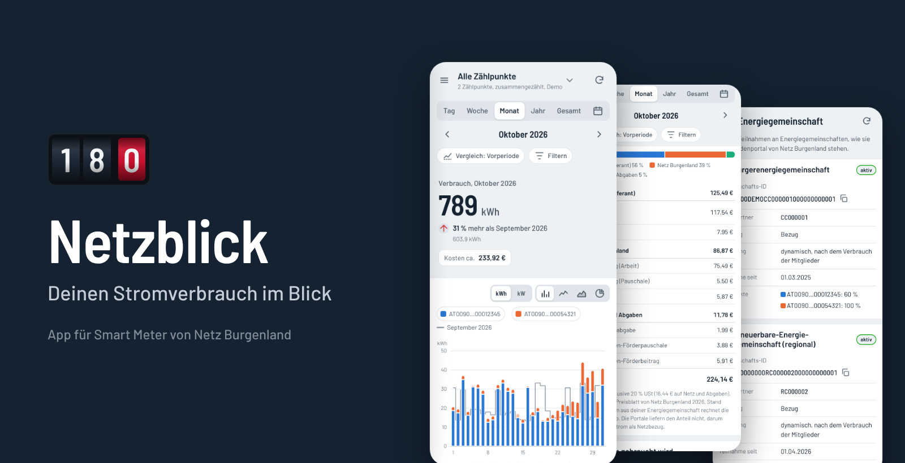
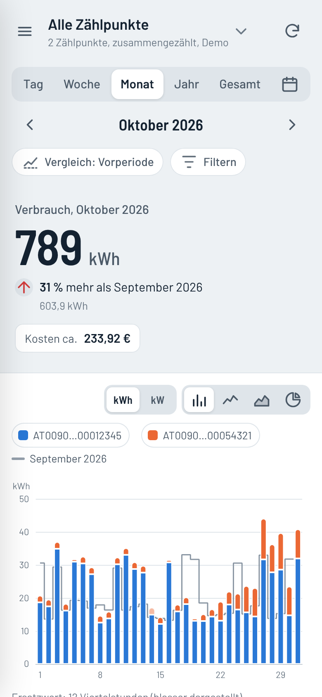
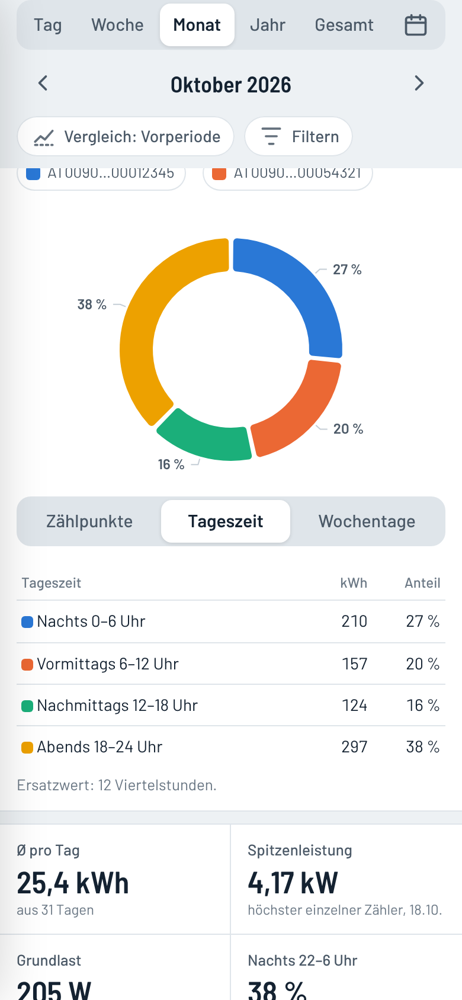
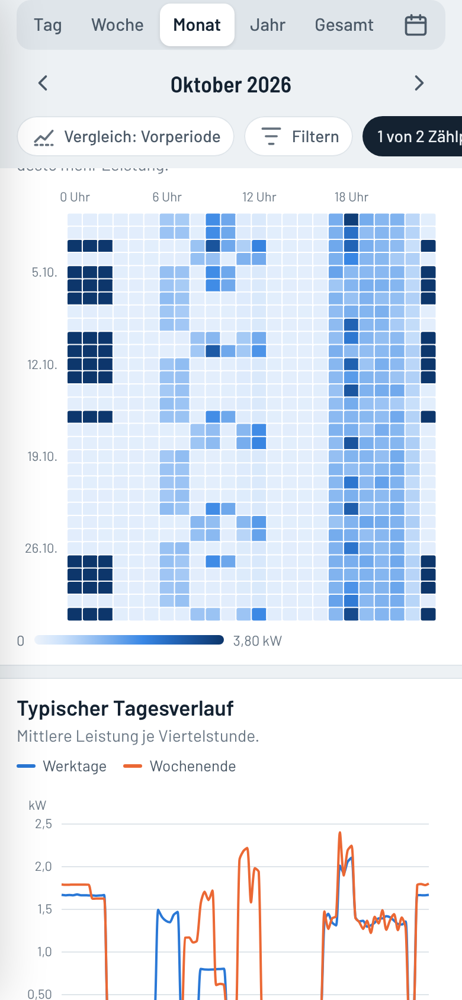
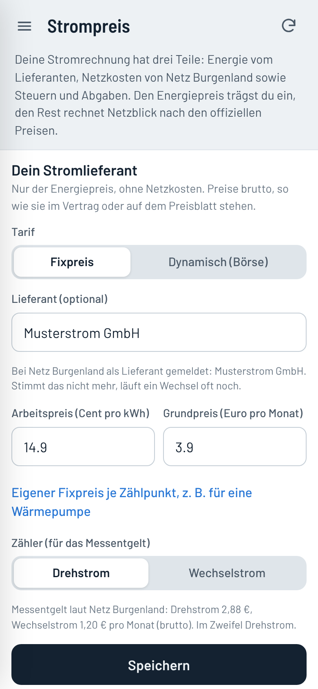
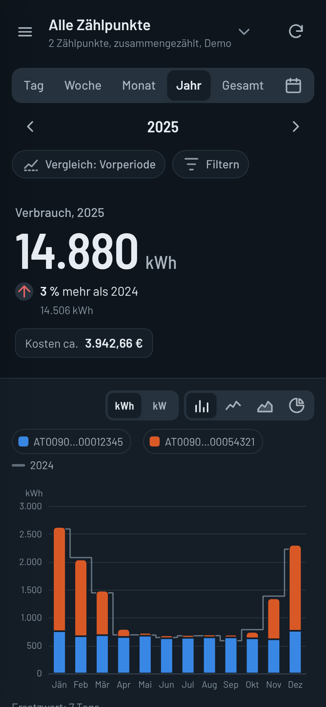
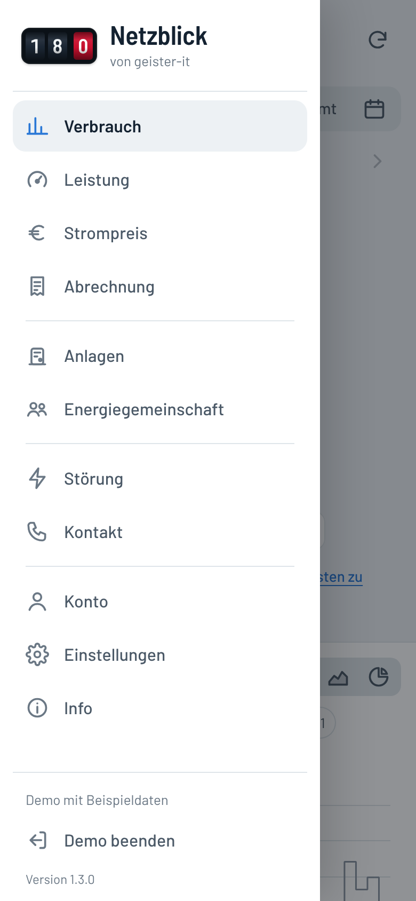
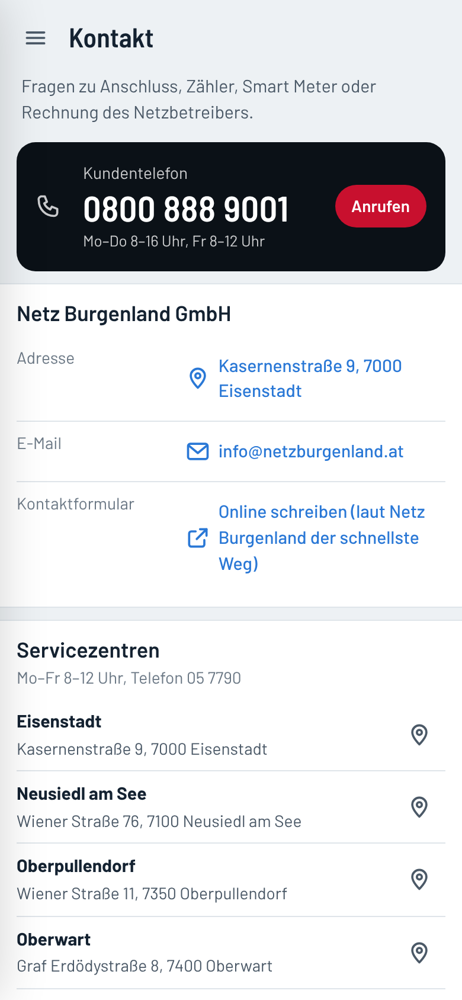
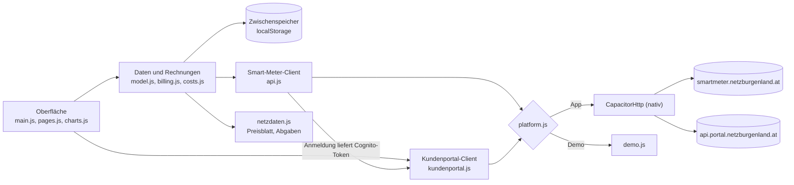

<div align="center">

**Deutsch** | [English](README.en.md)



[](https://github.com/xionix3/netzblick/actions/workflows/ci.yml)
[](https://github.com/xionix3/netzblick/releases)

</div>

**Netzblick** zeigt deine Smart-Meter-Daten von Netz Burgenland übersichtlich auf Handy und Tablet: Verbrauch in Viertelstunden, Tagen, Monaten und Jahren, deine Leistungsspitzen für den Leistungspreis ab 2027, was dich der Strom kostet, deine Anlagen, Abrechnungen und Energiegemeinschaften. Du meldest dich mit deinem gewohnten Zugang an. Das [Smart-Meter-Portal](https://smartmeter.netzburgenland.at/enview/enView.Portal/) und das [Kundenportal](https://portal.netzburgenland.at/) verwenden dieselbe Anmeldung, Netzblick verbindet beide.

> Netzblick ist ein privates Projekt von Patrick Schlögl (geister-it) und **keine offizielle App** von Netz Burgenland. Es nutzt dieselben Schnittstellen wie die Web-Portale. Ändert Netz Burgenland diese, kann die App vorübergehend ausfallen.

## Inhalt

- [So sieht es aus](#so-sieht-es-aus)
- [Funktionen](#funktionen)
- [Installation](#installation)
- [Bedienung](#bedienung)
- [Kennzahlen und Kosten erklärt](#kennzahlen-und-kosten-erklärt)
- [Datenschutz und Sicherheit](#datenschutz-und-sicherheit)
- [Immer aktuell bleiben](#immer-aktuell-bleiben)
- [Selbst bauen](#selbst-bauen)
- [Fehlerbehebung](#fehlerbehebung)
- [Entwicklung](#entwicklung)
- [Tests](#tests)
- [Releases und Play Store](#releases-und-play-store)
- [Lizenz](#lizenz)

## So sieht es aus

Alle Bilder zeigen den Demo-Modus mit erfundenen Beispieldaten.

<table>
  <tr>
    <td align="center" width="25%"><br /><sub><b>Übersicht</b><br />Summe, Vergleich, Hochrechnung</sub></td>
    <td align="center" width="25%"><br /><sub><b>Tag</b><br />Zählerstand und Viertelstunden</sub></td>
    <td align="center" width="25%"><br /><sub><b>Leistung</b><br />Viertelstunden, 10-kW-Grenze</sub></td>
    <td align="center" width="25%"><br /><sub><b>Leistung ab 2027</b><br />Monatsspitzen, Kostenvergleich</sub></td>
  </tr>
  <tr>
    <td align="center"><br /><sub><b>Kosten</b><br />Energie, Netz, Abgaben</sub></td>
    <td align="center"><br /><sub><b>Aufteilung</b><br />nach Zähler, Tageszeit, Wochentag</sub></td>
    <td align="center"><br /><sub><b>Analysen</b><br />Lastgang und Tagesverlauf</sub></td>
    <td align="center"><br /><sub><b>Strompreis</b><br />Lieferant und Erinnerung</sub></td>
  </tr>
  <tr>
    <td align="center"><br /><sub><b>Abrechnung</b><br />Hochrechnung und Teilbeträge</sub></td>
    <td align="center"><br /><sub><b>Energiegemeinschaft</b><br />Teilnahmen und Faktoren</sub></td>
    <td align="center"><br /><sub><b>Anlagen</b><br />Zähler, Netztarif, Lieferant</sub></td>
    <td align="center"><br /><sub><b>Störung</b><br />direkt anrufen</sub></td>
  </tr>
  <tr>
    <td align="center"><br /><sub><b>Dunkelmodus</b><br />Jahr im Vergleich</sub></td>
    <td align="center"><br /><sub><b>Menü</b><br />alles mit einem Tipp</sub></td>
    <td align="center"><br /><sub><b>Kontakt</b><br />Telefon, E-Mail, Servicezentren</sub></td>
  </tr>
</table>

<p align="center"><br /><sub><b>Tablet</b>: Menü am Rand, Summe neben dem Diagramm. Auch das Handy im Querformat zeigt beides nebeneinander.</sub></p>

## Funktionen

### Verbrauch

| | |
|---|---|
| **Zeiträume** | Tag, Woche, Monat, Jahr, Gesamt und frei wählbar, auch „seit der letzten Abrechnung“. Blättern mit Pfeilen oder Wischen. |
| **Zählerstand** | Aktueller Stand des Bezugszählers als Rollenzählwerk. |
| **Vergleich** | Mit Vorperiode oder Vorjahr; bei laufenden Zeiträumen fair bis zum gleichen Zeitpunkt. |
| **Diagramme** | Balken, Linien, Fläche oder Kreis. Leistungskurve in Viertelstunden, Balken je Tag, Monat oder Jahr, Vergleich als graue Linie. |
| **Analysen** | Lastgang-Teppich, typischer Tagesverlauf (Werktag, Wochenende), Verbrauch je Wochentag, Jahreskalender, Jahre im Vergleich. |
| **Filter** | Wochentage und Uhrzeiten (z. B. nachts 22–6 Uhr); wirken auf alle Zahlen und Diagramme. |
| **Mehrere Zählpunkte** | Beliebig kombinierbar, in der Legende ein- und ausblenden. Ohne eigenen Namen heißt jeder Zählpunkt nach seiner Nummer. |
| **Werte und Export** | Wertetabelle und CSV-Export (Excel-tauglich). Ersatz-, vorläufige und fehlende Werte sind markiert. |

### Leistung (ab 2027)

| | |
|---|---|
| **kWh oder kW** | Über dem Diagramm umschalten. In kW zeigt Netzblick die mittlere Leistung jeder Viertelstunde, auch für einen ganzen Monat. Im Jahr und Gesamt die höchste Viertelstunde je Monat. |
| **10-kW-Linie** | Ein- und ausblendbar. Ab 2027 kostet der Anteil der Monatsspitze über 10 kW mehr. Die höchste Spitze ist markiert, darunter steht je Zählpunkt, wie oft sie über 10 kW lag. |
| **Seite „Leistung“** | Monatsspitzen der letzten 13 Monate je Zählpunkt, Monate über 10 kW, Spitze im laufenden Monat, Leistungspreis pro Jahr, Netzkosten 2026 gegen ab 2027, Tipps. |
| **Grundlage** | Entwurf der Tarifverordnung 2027 der E-Control (29.10.2026), Netzbereich Burgenland. Netz Burgenland kündigt die Umstellung für Jänner 2027 an. |

### Kosten und Abrechnung

| | |
|---|---|
| **Strompreis** | Arbeitspreis und Grundpreis deines Lieferanten eintragen, auf Wunsch je Zählpunkt (z. B. Wärmepumpe). |
| **Netzkosten** | Rechnet Netzblick selbst nach dem Preisblatt von Netz Burgenland, samt Sommer-Niedertarif (1. April bis 30. September, 10–16 Uhr) aus den Viertelstundenwerten. Ab 2027 mit Leistungspreis aus der Monatsspitze und Winter-Niedertarif (ab Oktober 2027, 23–5 Uhr). Haushalt oder unterbrechbar kommt aus dem Kundenportal. |
| **Steuern und Abgaben** | Elektrizitätsabgabe, Erneuerbaren-Förderpauschale und -Förderbeitrag, 20 % USt. |
| **Kostenaufstellung** | In der Übersicht mit Anteilen; Kosten pro Tag und Hochrechnung auf den Zeitraum. „Was dich ein Jahr kostet“ aus den letzten 12 Monaten. |
| **Erinnerung** | Benachrichtigung und Hinweis, bevor Neukundenrabatt oder Vertragsbindung enden; Kalendereintrag; Link zum Tarifkalkulator der E-Control. |
| **Abrechnung** | Laufendes Abrechnungsjahr mit Hochrechnung, gemessen gegen abgerechnet, Kosten gegen Teilbeträge, abgerechnete Jahresverbräuche, Rechnungen. |

### Netz Burgenland

| | |
|---|---|
| **Anlagen** | Zählpunktnummer, Adresse, Zählernummer, Gerät, Netztarif, Netzebene, Lastprofil, Lieferant, Vertragsbeginn, letzte Abrechnung. |
| **Energiegemeinschaft** | Alle Teilnahmen: Art der Gemeinschaft, Gemeinschafts-ID, Marktpartner, Richtung, Aufteilung, Status, Teilnahmefaktor je Zählpunkt und Verlauf. |
| **Störung** | Störungsdienst und Stromnotruf direkt anrufen, Hinweise vor dem Anruf, Störungskarte, Online-Meldung. |
| **Kontakt** | Kundentelefon, E-Mail, Kontaktformular, Servicezentren mit Karte, Themen-Links. |

### Komfort

Hoch- und Querformat, für Handy und Tablet gebaut, Dunkelmodus, Offline-Anzeige der zuletzt geladenen Werte, automatische Neuanmeldung, Demo-Modus mit Beispieldaten, animiertes Markenzeichen beim Start.

## Installation

1. Unter [**Releases**](https://github.com/xionix3/netzblick/releases) die neueste `netzblick-X.Y.Z.apk` am Handy herunterladen.
2. Die Datei öffnen. Android fragt einmalig, ob dein Browser bzw. Dateimanager Apps installieren darf: erlauben.
3. Netzblick öffnen und mit Benutzername (oder E-Mail-Adresse) und Passwort deines Netz-Burgenland-Zugangs anmelden. Hast du im Kundenportal ein anderes Konto, klapp „Andere Zugangsdaten für das Kundenportal?“ auf.

Updates installierst du genauso, über die vorhandene App. Voraussetzung ist Android 7.0 oder neuer.
Noch keinen Zugang? Registrieren kannst du dich unter [portal.netzburgenland.at](https://portal.netzburgenland.at/auth/). Zum Ausprobieren gibt es auf der Anmeldeseite **„Demo mit Beispieldaten ansehen“**.

## Bedienung

- **Menü:** ☰ oben links oder vom linken Rand wischen. Auf dem Tablet steht es fest am Rand.
  Verbrauch, Leistung, Strompreis, Abrechnung, Anlagen, Energiegemeinschaft, Störung, Kontakt, Konto, Einstellungen, Info, Abmelden.
- **Zeitraum:** Leiste oben. Das Kalendersymbol öffnet einen eigenen Zeitraum mit Schnellwahl.
- **Blättern:** Pfeile neben dem Datum oder auf der Summe wischen. Ein Tipp aufs Datum öffnet die Datumsauswahl.
- **Zählpunkte:** Tipp auf den Namen oben (mehrere ankreuzen oder „nur dieser“), oder in der Diagrammlegende antippen.
- **kWh oder kW:** Schalter rechts über dem Diagramm. In kW gibt es die Viertelstunden und unter dem Diagramm den Schalter für die 10-kW-Linie.
- **Diagrammart:** Symbole rechts über dem Diagramm; die Wahl wird je Auflösung gemerkt.
- **Vergleich und Filter:** Chips unter dem Datum. Aktive Filter erscheinen dunkel und lassen sich mit ✕ entfernen.
- **Strompreis:** Preis des Lieferanten (brutto), Erinnerung an Rabatt- oder Bindungsende, Jahreskosten, Netzpreise.
- **Konto:** Status beider Portale; dort wählst du, ob das Kundenportal die Smart-Meter-Anmeldung nutzt, eigene Zugangsdaten bekommt oder aus ist.
- **Einstellungen:** Namen der Zählpunkte, Hell oder Dunkel.

## Kennzahlen und Kosten erklärt

| Kennzahl | Bedeutung und Berechnung |
|---|---|
| **Verbrauch** | Summe aller Messwerte im Zeitraum in kWh, ggf. gefiltert. |
| **Vergleich** | Änderung gegenüber dem Vergleichszeitraum. Läuft der Zeitraum noch, wird der Vergleich auf dieselbe Dauer gekürzt. |
| **Hochrechnung** | Ø pro Tag × Tage des ganzen Zeitraums; ab 1 Tag Daten (Woche), 3 Tagen (Monat) bzw. 14 Tagen (Jahr). |
| **Ø pro Tag** | Verbrauch ÷ Tage mit Messwerten; angebrochene Tage zählen anteilig. |
| **Spitzenleistung** | Höchster Viertelstundenwert × 4 = mittlere Leistung in kW in dieser Viertelstunde. Bei mehreren Zählpunkten der höchste einzelne. |
| **Leistungspreis (ab 2027)** | Je Zählpunkt und Monat die höchste Viertelstunde, auf zwei Kommastellen gerundet: bis 10 kW × 3,40 €, Anteil darüber × 5,10 € (netto, Entwurf). Beispiel 12 kW: 10 × 3,40 + 2 × 5,10 = 44,20 € netto im Monat. Unterbrechbare Zählpunkte zahlen keinen. |
| **Grundlast** | 10-%-Wert der Viertelstundenleistung: was praktisch immer läuft. Ein guter Ansatzpunkt zum Sparen. |
| **Nachts 22–6 Uhr** | Anteil des Verbrauchs zwischen 22 und 6 Uhr. |
| **Kosten** | **Lieferant:** kWh × Arbeitspreis + Grundpreis anteilig (brutto, wie eingegeben). **Netz Burgenland** (Netzebene 7, netto + 20 % USt): kWh × Netznutzung, Viertelstunden von April bis September zwischen 10 und 16 Uhr zum Sommer-Niedertarif, dazu Pauschale pro Jahr und Messentgelt pro Monat anteilig. **Abgaben:** Elektrizitätsabgabe je kWh, Erneuerbaren-Förderpauschale pro Jahr, Erneuerbaren-Förderbeitrag pro Jahr und je kWh. Preise in [`src/netzdaten.js`](src/netzdaten.js). Eine Schätzung, maßgeblich ist deine Rechnung. |
| **Abrechnungsjahr** | Verbrauch seit Ende der letzten Abrechnung × (Verbrauch der 12 Monate davor ÷ dieselbe Zeitspanne vor einem Jahr). So zählt der Winter mehr als der Sommer. Ab 14 Tagen. |

**Datenquellen:** Viertelstundenwerte (Register 1.8.0, ab Mitte 2023) und Tageswerte je Tarif (1.8.1/1.8.2, seit Einbau des Smart Meters); Netzblick nimmt automatisch die feinsten verfügbaren Daten. Messwerte kommen etwa einen Tag verzögert.
**Statuscodes:** W = gemessen, E = Ersatzwert, V = vorläufig, F = fehlend, G = gestört, M = manuell. Alles außer „W“ wird blasser dargestellt bzw. in der Tabelle markiert.

## Datenschutz und Sicherheit

- Netzblick spricht **ausschließlich** mit `smartmeter.netzburgenland.at` und `api.portal.netzburgenland.at` (HTTPS). Kein eigener Server, keine Werbung, kein Tracking.
- Vom Kundenportal werden Daten nur **gelesen**.
- **Zugangsdaten** werden nur bei „Angemeldet bleiben“ gespeichert, verschlüsselt mit AES-256-GCM; der Schlüssel liegt im Android Keystore.
- **Messwerte** werden für die Offline-Anzeige zwischengespeichert. „Abmelden“ löscht Zugangsdaten und Zwischenspeicher.
- Android-Backups sind aus. Berechtigungen: Internet, Benachrichtigungen (nur für die Erinnerung), Neustart-Empfang (damit eine geplante Erinnerung bleibt).

Ausführlich in der [Datenschutzerklärung](DATENSCHUTZ.md).

## Immer aktuell bleiben

Für alle, die die App selbst mit Android Studio bauen. Neue Versionen landen auf GitHub im Zweig `main`.

**Unter Windows:** Im Projektordner doppelt auf **`aktualisieren.cmd`** klicken. Das Skript holt den neuesten Stand von GitHub, installiert neue Pakete und kopiert die Oberfläche ins Android-Projekt. Danach in Android Studio auf **Run** ▶ drücken.

**Von Hand** (cmd, PowerShell oder Terminal, im Projektordner):

```bash
git pull
npm run sync
```

`npm run sync` installiert fehlende Pakete selbst und baut die Oberfläche. Dann in Android Studio **Run** ▶.

> Ändere im Projektordner nichts von Hand, dann klappt `git pull` immer. Hat Android Studio Dateien verändert (z. B. ein vorgeschlagenes Gradle-Upgrade), setzt `git checkout -- android` sie zurück.

Ohne Android Studio geht es noch einfacher: die neueste APK unter [Releases](https://github.com/xionix3/netzblick/releases) am Handy installieren.

## Selbst bauen

| Werkzeug | Version | Hinweis |
|---|---|---|
| [Node.js](https://nodejs.org) | 22 oder neuer | siehe `.nvmrc` |
| [Android Studio](https://developer.android.com/studio) | **Otter (2025.2.1) oder neuer** | bringt JDK 21 und das Android-SDK mit |
| Git | aktuell | |

```bash
git clone https://github.com/xionix3/netzblick.git
cd netzblick
npm run sync          # Pakete installieren, Oberfläche bauen, ins Android-Projekt kopieren
```

Dann in Android Studio den Ordner **`android/`** öffnen, warten bis Gradle fertig ist, Handy mit USB-Debugging anschließen und **Run** drücken. Ohne Android Studio, aber mit SDK: `npm run apk`.
Jeder Push baut auf GitHub außerdem eine Debug-APK (**Actions** → Lauf → **Artifacts**).

## Fehlerbehebung

| Meldung / Problem | Lösung |
|---|---|
| `incompatible version (AGP 8.13.0) of the Android Gradle plugin` | Android Studio ist zu alt: Otter (2025.2.1) oder neuer installieren. |
| Android Studio schlägt ein Upgrade auf AGP 9 vor | Ablehnen. Capacitor 8 ist mit AGP 8.13 getestet. |
| `error: invalid source release: 21` | *Settings → Build Tools → Gradle → Gradle JDK* auf das mitgelieferte JDK 21 stellen. |
| `SDK location not found` | Projekt einmal in Android Studio öffnen oder `ANDROID_HOME` setzen. |
| `Could not resolve "@capacitor/…"` | Neues Paket nach `git pull`. `npm run sync` installiert es ab Version 1.2.0 selbst, sonst einmal `npm install`. |
| `npm warn install-scripts … esbuild … blocked` (npm 12) | Ist in `package.json` freigegeben. Einmal `npm rebuild esbuild`. Nach `npm install-scripts approve`: `git checkout -- package.json`. |
| Anmeldung schlägt fehl, Passwort stimmt | Im [Web-Portal](https://smartmeter.netzburgenland.at/enview/enView.Portal/) anmelden; verlangt es ein neues Passwort, dort ändern. |
| Heute fehlen Werte | Normal, die Werte kommen etwa einen Tag verzögert. |
| „Anlagen“ oder „Abrechnung“ leer | Unter *Konto* den Zugang zum Kundenportal prüfen, ggf. „Eigene Zugangsdaten“ wählen. |
| „Rechnungen stellt … aus“ | Dein Lieferant rechnet direkt ab; Verbräuche und Hochrechnung funktionieren trotzdem. |
| „App nicht installiert“ beim Update | Andere Signatur (Debug statt Release): alte Version deinstallieren und neu installieren. |
| Keine Erinnerung am Handy | Benachrichtigungen für Netzblick in den Android-Einstellungen erlauben; der Hinweis in der Übersicht erscheint trotzdem. |

## Entwicklung

```
netzblick/
├── src/                 App-Logik (JavaScript, mit esbuild gebündelt)
│   ├── api.js           Smart-Meter-API: Anmeldung, Messreihen, Spitzenleistung
│   ├── kundenportal.js  Kundenportal: Profil, Zählpunkte, Energiegemeinschaften, Verträge, Abrechnung
│   ├── model.js         Laden, Zwischenspeichern, Filtern, Kennzahlen, Aufteilung
│   ├── costs.js         Kostenmodell: Lieferant, Netz, Abgaben, Niedertarife, Leistungspreis ab 2027
│   ├── netzdaten.js     Netzpreise, Abgaben, Störungs- und Kontaktdaten (mit Quellen)
│   ├── billing.js       Laufendes Abrechnungsjahr und Hochrechnung
│   ├── reminder.js      Erinnerung: Zeitpunkt und Kalenderdatei
│   ├── charts.js        Diagramme (Apache ECharts)
│   ├── main.js          Start, Anmeldung, Menü, Verbrauchsansicht
│   ├── pages.js         Seiten Leistung, Strompreis, Abrechnung, Anlagen, Energiegemeinschaft, Störung, Kontakt, Konto, Info
│   ├── ui.js            DOM-Helfer, Bottom-Sheet, Rollenzählwerk, Markenzeichen
│   ├── platform.js      Native Brücke: HTTP ohne CORS, sicherer Speicher, Teilen, Benachrichtigungen
│   ├── demo.js          Demo-Daten im Format der echten APIs
│   └── cache.js, format.js, icons.js, time.js
├── www-src/             index.html und app.css
├── android/             Capacitor-Android-Projekt (SecureStorePlugin.java: Keystore-Verschlüsselung)
├── test/unit/           Unit-Tests (node:test)
├── test/e2e/            Oberflächentest im echten Chrome
├── scripts/             Build-, Release- und Bild-Skripte
└── docs/                API, Releases, Play Store, Tester, Bilder
```



| Befehl | Zweck |
|---|---|
| `npm test` | Unit-Tests |
| `npm run build` | Oberfläche nach `www/` bauen (installiert fehlende Pakete) |
| `npm run sync` | Build und Kopie ins Android-Projekt |
| `npm run test:e2e` | Oberflächentest in Chrome |
| `npm run screenshots` | Oberflächentest, aktualisiert `docs/screenshots/` |
| `node scripts/readme-images.mjs` | Bilder dieser README (`docs/readme/`) |
| `node scripts/store-assets.mjs` | Grafiken für Google Play (`docs/store/`) |
| `npm run check` | Tests, Build und Oberflächentest zusammen |
| `npm run apk` | Debug-APK über die Kommandozeile |

**Im Browser:** `npm run build`, dann `www/` mit einem lokalen Webserver ausliefern (z. B. `npx serve www`) und `?demo=1` anhängen. Die echte Anmeldung geht nur in der App; der Browser blockiert die Portal-APIs (CORS).
**Schnittstellen:** [docs/API.md](docs/API.md).

## Tests

Bei jedem Push laufen auf GitHub drei Stufen ([CI](.github/workflows/ci.yml)):

1. **Unit-Tests** (`test/unit/`, 81 Fälle): Zeiträume inkl. Zeitumstellung, Zahlenformate, API-Clients mit Fehlerfällen und Neuanmeldung, Datenmodell und Filter, Zwischenspeicher, Kundenportal und Energiegemeinschaften, Abrechnungsjahr inkl. Zwischenabrechnung, Kostenmodell (geprüft gegen die Vergleichsgrafik von Netz Burgenland), Leistungspreis 2027 mit Monatsspitzen und Winter-Niedertarif, Erinnerung und Kalenderdatei, Versionsnummern.
2. **Oberflächentest** (`test/e2e/smoke.mjs`, 24 Szenarien): alle Zeiträume, Dunkelmodus, Filter, Mehrfachauswahl, Diagrammarten, Leistungsansicht mit 10-kW-Linie, Kosten und Erinnerung, alle Seiten, Tablet, Querformat, hohe Statusleiste, Abmelden. Prüft auf Konsolenfehler, leere Ansichten und kaputte Texte.
3. **Android-Build**: baut die Debug-APK.

## Releases und Play Store

- **Neue Version:** Eintrag in [CHANGELOG.md](CHANGELOG.md), Version in `package.json` erhöhen und nach `main` pushen. GitHub baut signierte APK und AAB, setzt den Tag und legt beides unter **Releases** ab.
- **Release-Schlüssel** (einmalig): [docs/RELEASE.md](docs/RELEASE.md).
- **Play Store:** Checkliste, Store-Texte und Datensicherheit in [docs/PLAY-STORE.md](docs/PLAY-STORE.md), Anleitung für Tester in [docs/TESTER.md](docs/TESTER.md).

## Lizenz

[MIT](LICENSE), © 2026 Patrick Schlögl (geister-it), patrick-schloegl@gmx.at. Netzblick steht in keiner Verbindung zu Netz Burgenland oder VIVAVIS; genannte Namen gehören ihren Inhabern.
Verwendet [Capacitor](https://capacitorjs.com) (MIT), [Apache ECharts](https://echarts.apache.org) (Apache-2.0) und die Schrift [Barlow](https://github.com/jpt/barlow) (SIL OFL 1.1).
